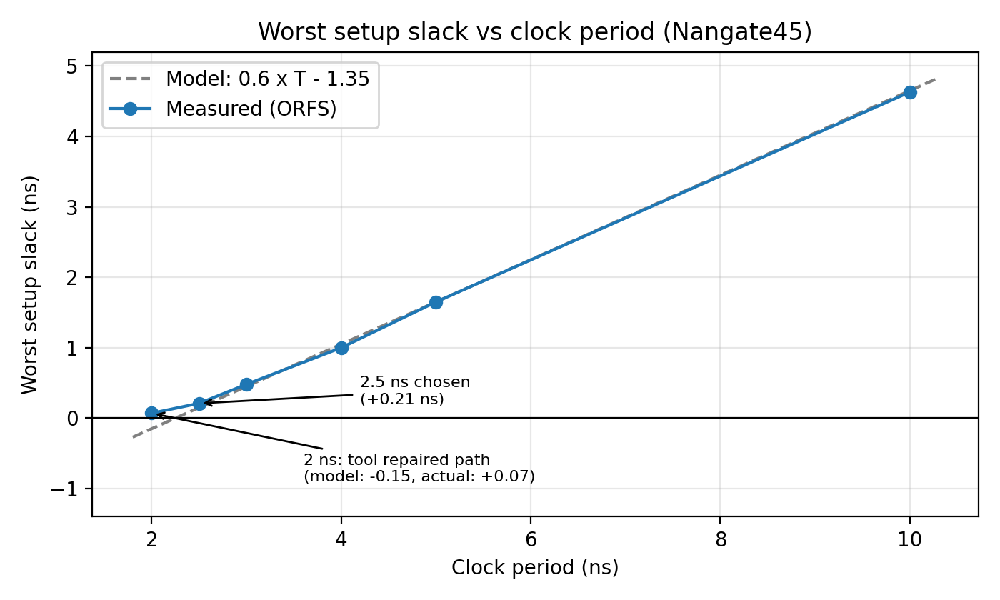
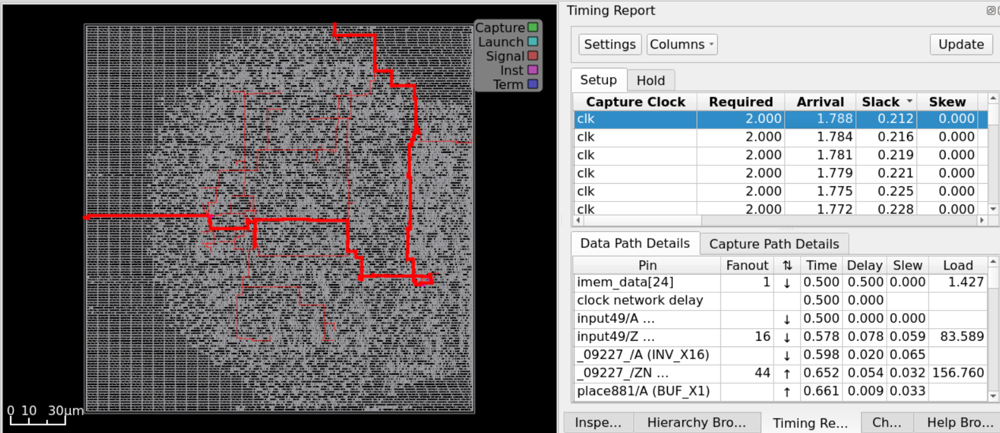
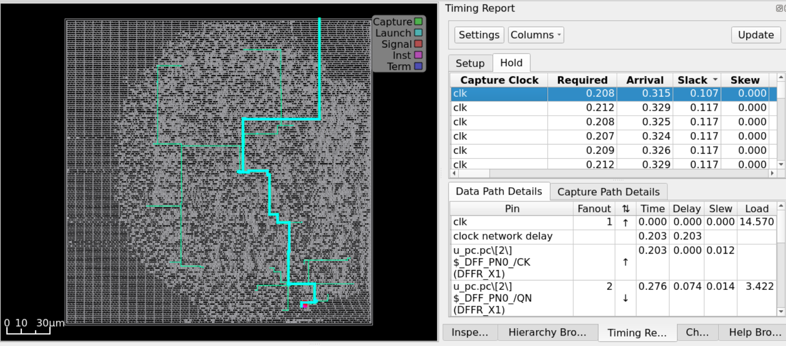
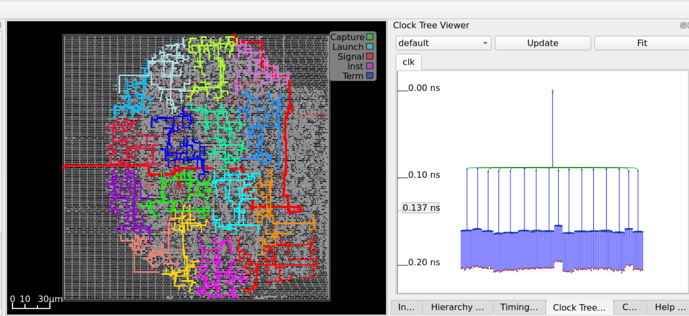

# Single-Cycle RISC-V Core: RTL-to-GDSII with OpenROAD (Nangate45)

A single-cycle RISC-V core taken through synthesis, floorplan, placement, clock tree synthesis, routing and GDS generation with the OpenROAD-flow-scripts (ORFS) on the Nangate45 45 nm open library, followed by a clock-period sweep and a review of setup, hold and reset-removal timing.

**Version:** v1 (physical-design results). Functional verification is limited to one directed test; see [Limitations](#limitations).

**Author:** Deepesh M

---

## 1. Design

| Item | Detail |
|---|---|
| Architecture | Single-cycle RISC-V core (RV32I subset) |
| Modules | `alu`, `register_file` (32 x 32), `instruction_decoder`, `control_unit`, `immediate_gen`, `branch_unit`, `prog_count` |
| Top level | `riscv_core` (core only, with instruction and data memory ports) |
| Simulation wrapper | `riscv_top` (core plus behavioral instruction and data memories) |
| Technology | Nangate45 (ORFS platform `nangate45`) |
| Tools | Yosys (synthesis), OpenROAD 26Q3 (PnR), run inside Docker |

Instructions exercised by the testbench: `addi`, `add`, `sub`, `sw`, `lw`, `beq`.

### Core interface

The memories are deliberately **outside** the core so the physical design measures the processor itself:

- Instruction memory: `imem_addr` (out), `imem_data` (in)
- Data memory: `dmem_addr`, `dmem_wdata`, `dmem_read`, `dmem_write` (out), `dmem_rdata` (in)
- Debug outputs: `debug_pc`, `debug_instruction`, `debug_alu_result`, `debug_write_data`

### Repository layout

```
designs/riscv_core/
  src/    core RTL only (this is what synthesis reads)
  sim/    instruction_memory.v, data_memory.v, riscv_top.v (simulation only)
  tb/     tb_riscv_core.v
designs/nangate45/riscv_core/
  config.mk, constraint.sdc, constraint_<period>.sdc (sweep copies)
```

---

## 2. Flow configuration

Key settings in `config.mk`:

| Variable | Value |
|---|---|
| `CORE_UTILIZATION` | 30 |
| `CORE_ASPECT_RATIO` | 1 |
| `PLACE_DENSITY_LB_ADDON` | 0.20 |
| `ABC_AREA` | 1 (synthesis optimizes for area) |
| `SKIP_CTS_REPAIR_TIMING` | 1 (no timing repair after CTS) |

Constraints (`constraint.sdc`): one clock `clk`; input and output external delays are **20% of the clock period** each (an assumption standing in for real memory timing).

---

## 3. A debugging story: the first run was hollow

The first full run looked excellent (worst setup slack 7.77 ns at a 10 ns clock) but synthesis reported only **30 flip-flops and 436 µm²**. A core with a 32 x 32 register file should have more than 1,000 flops.

**Cause:** `instruction_memory.v` had an empty `initial` block (the testbench loads programs only in simulation). Synthesis saw a ROM with constant contents, so the instruction was constant `0x00000000`. That made the control signals constant, `reg_write` and `mem_write` were never 1, and Yosys correctly removed the register file and data memory. Only the PC logic survived.

**How it was confirmed:** the netlist showed `debug_instruction` bits driven by the single `LOGIC0_X1` cell.

**Fix:** move the memories out of the synthesized core, give `riscv_core` memory-interface ports, and add a simulation-only wrapper. The testbench still passes after the change (x1=5, x2=10, x3=15, x4=5, x5=15, x6=0, x7=42, mem[0]=15).

**Result:** 1,024 flops (register file plus PC) and about 13.5k µm² after synthesis.

**Lesson:** always sanity-check flop count and area against what the RTL should produce before trusting timing numbers.

---

## 4. Baseline results (10 ns clock)

| Metric | Value |
|---|---|
| Synthesis area | 13,489 µm² (1,024 flops, 5,448 µm² sequential) |
| Final area | 13,832 µm² at 31% utilization |
| Worst setup slack | 4.63 ns (input-to-output path, see below) |
| Flop-to-flop setup slack | 8.59 ns (register file to PC, about 1.4 ns of logic) |
| Hold slack | +0.11 ns (PC to PC) |
| Reset removal slack | +1.63 ns |
| Clock skew | about 0.01 ns |
| Total power | 2.10 mW (sequential 44%, combinational 32%, clock 24%) |

Power uses default switching activity (no real program), so treat it as a relative number.

**Worst setup path:** `imem_data[21]` to `debug_write_data[26]`. It passes through instruction decode, register read, the ALU adder and the write-back mux, in about 1.37 ns of logic. The remaining 4 ns of the budget are the 2 ns input and 2 ns output external delays.

---

## 5. Clock-period sweep

Each period was run as its own ORFS flow variant (`FLOW_VARIANT=p<period>`) with a copy of the SDC.

| Period (ns) | Worst setup slack (ns) | Area (µm²) | WNS / TNS |
|---|---|---|---|
| 10 | 4.63 | 13,832 | 0 / 0 |
| 5 | 1.65 | 13,830 | 0 / 0 |
| 4 | 1.00 | 13,823 | 0 / 0 |
| 3 | 0.48 | 13,819 | 0 / 0 |
| 2.5 | 0.21 | 13,835 | 0 / 0 |
| 2 | 0.07 | 13,979 | 0 / 0 |

Hold and reset-removal slack at the fast periods:

| Period (ns) | Hold slack (ns) | Removal slack (ns) |
|---|---|---|
| 3 | 0.11 | 0.23 |
| 2.5 | 0.11 | 0.12 |
| 2 | 0.11 | 0.02 |



### Findings

- **Setup slack follows a simple model:** slack is approximately `0.6 x T - 1.35` (ns). The 0.6 comes from the 20% input and 20% output delays shrinking the budget; the 1.35 ns is the logic delay of the worst path. The fit is within about 0.05 ns from 10 ns down to 3 ns.
- **At 2 ns the tool repaired the path:** the model predicts -0.15 ns, but timing met with +0.07 ns. The logic delay dropped from about 1.35 ns to about 1.13 ns, at a cost of roughly 150 µm² (about 1% area).
- **Hold does not depend on the period:** it stays at +0.11 ns because both launch and capture are on the same clock edge.
- **Reset removal is the next limit:** its slack shrinks with the period (the reset input delay is 20% of it) and is only +0.02 ns at 2 ns. It would be expected to fail below roughly 1.9 ns. This limit comes from how reset is constrained, not from the processor's logic.
- **Small area differences (about ±10 µm²) at 5 to 2.5 ns are run-to-run noise.** Only the jump at 2 ns is a real effect.

### Chosen operating point

**2.5 ns (400 MHz):** setup +0.21 ns, hold +0.11 ns, removal +0.12 ns, no area penalty.
2 ns (500 MHz) also passes all three checks, but with almost no margin (removal +0.02 ns) and about 1% more area, so it is reported as the aggressive point rather than the headline.

### Timing views at 2.5 ns


*Worst setup path: `imem_data[24]` to an output port, slack +0.21 ns. The 0.5 ns input delay (20% of the period) is part of the arrival time.*


*Worst hold path: `u_pc` flop to flop, slack +0.11 ns.*


*Clock tree after CTS: about 0.14 to 0.2 ns insertion delay, balanced over all 1,024 flops.*

---

## 6. Reproducing the results

Inside the ORFS Docker container, from `/OpenROAD-flow-scripts/flow`:

```bash
# simulation (from designs/riscv_core)
iverilog -o sim.out src/*.v sim/*.v tb/tb_riscv_core.v && vvp sim.out

# baseline flow
make DESIGN_CONFIG=./designs/nangate45/riscv_core/config.mk FLOW_VARIANT=core_only

# clock sweep
D=designs/nangate45/riscv_core
for P in 5 4 3 2.5 2; do
  sed "s/set clk_period .*/set clk_period $P/" $D/constraint.sdc > $D/constraint_$P.sdc
  make DESIGN_CONFIG=./$D/config.mk FLOW_VARIANT=p$P \
       SDC_FILE=/OpenROAD-flow-scripts/flow/$D/constraint_$P.sdc
done

# collect setup results
for P in 5 4 3 2.5 2; do
  echo "== period $P"
  grep -E "^(wns|tns|worst slack)" reports/nangate45/riscv_core/p$P/6_finish.rpt
  grep -rh "Design area" logs/nangate45/riscv_core/p$P/ | tail -1
done
```

---

## 7. Limitations

- **Functional verification is minimal:** one directed test covering `addi`, `add`, `sub`, `sw`, `lw` and `beq`. No compliance suite and no UVM environment yet.
- Single-cycle microarchitecture; the register file is built from flip-flops, and memories are behavioral and outside the core.
- External I/O delays are an assumption (20% of the period), not measured memory timing.
- `SKIP_CTS_REPAIR_TIMING=1`: hold and removal were checked but never repaired by the tool.
- The worst setup path is an input-to-output path created by the I/O constraints and the debug ports; the core's own flop-to-flop path is faster.
- Each period was run once; there is no seed or variance study.
- Power was computed with default switching activity.

---

## 8. Next steps

1. Verification: self-checking tests, more directed tests, then a UVM environment with monitor, scoreboard and coverage, and RISC-V compliance tests.
2. Re-run the flow if verification changes the RTL, and update the tables.
3. Utilization and placement-density sweeps (for example 30%, 45%, 60%) to study congestion and wire length.
4. A pipelined version (5-stage with forwarding and hazard handling) compared against this baseline.
5. Memories as macros (for example ORFS `fakeram45`) instead of flops.
